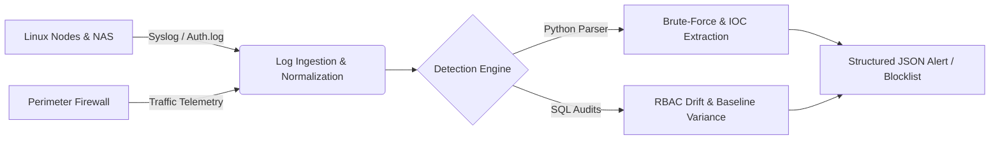

# 🛡️ SecOps Engineering & Detection Lab


An enterprise-simulated security operations, detection engineering, and infrastructure hardening environment. This repository houses custom **Python automation scripts**, **SQL telemetry queries**, and **IAM governance configurations** designed to ingest logs, detect anomalous behavior, and enforce least-privilege access across a multi-node Linux and network infrastructure.

---

## 🏗️ Telemetry & Detection Architecture



---

## 📂 Repository Structure

```text
secops-engineering-lab/
├── detection-sql/          # SQL queries for anomalous auth, privilege escalation & baseline variance
├── python-automation/      # Custom log parsers, IOC extractors, and automated incident triage scripts
├── iam-governance/         # Active Directory RBAC policy audits, least-privilege checks & NIST CSF risk register
└── infra-hardening/        # Linux sysctl/SSH hardening scripts & perimeter firewall baselines
```

---

## ⚙️ Core Engineering Modules

### 1. Automated Log Triage & Anomaly Detection (`/python-automation`)
* **Problem:** High-volume authentication and network logs create alert fatigue during manual incident triage.
* **Engineering Solution:** Python automation scripts that parse raw Linux `/var/log/auth.log` and perimeter telemetry using regex and sliding time-windows to flag brute-force patterns, impossible travel, and unauthorized access attempts.
* **Output:** Generates structured JSON alerts and automated IP blocklists for firewall ingestion.

### 2. SQL Telemetry & Identity Auditing (`/detection-sql`)
* **Problem:** Detecting subtle privilege creep and anomalous data access across large enterprise datasets.
* **Engineering Solution:** High-efficiency SQL queries utilizing window functions and statistical baselines to identify off-hours authentication spikes, dormant account reactivation, and Role-Based Access Control (RBAC) policy deviations.

### 3. IAM Governance & NIST CSF Alignment (`/iam-governance`)
* **Problem:** Ensuring technical controls map directly to regulatory and organizational risk frameworks.
* **Engineering Solution:** Comprehensive risk register and technical audit checklists evaluating Identity & Access Management (Active Directory, MFA enforcement, Least Privilege) and asset security against **NIST CSF**, **NIST SP 800-61**, and **CIS Controls**.

### 4. Host & Perimeter Hardening (`/infra-hardening`)
* **Problem:** Securing self-hosted virtualized Linux nodes (Ubuntu/Debian) and Network-Attached Storage (NAS) against external exposure.
* **Engineering Solution:** Automated Bash hardening scripts enforcing SSH key-only authentication, least-privilege file permissions, network segmentation, and host-level firewall parameters.

---

## 🚨 Sample Detection Output

Example structured alert generated by `python-automation/auth_log_analyzer.py` upon detecting a threshold breach:

```json
{
  "timestamp": "2026-10-29T21:14:02Z",
  "alert_type": "SSH_BRUTE_FORCE_DETECTED",
  "severity": "HIGH",
  "source_ip": "198.51.100.42",
  "failed_attempts": 28,
  "time_window_seconds": 60,
  "targeted_accounts": ["root", "admin", "ubuntu"],
  "recommended_action": "DENY_INGRESS_FIREWALL",
  "mitre_attack_id": "T1110.001"
}
```

---

## 🚀 Quickstart & Usage

```bash
# Clone the repository
git clone [https://github.com/](https://github.com/)<your-username>/secops-engineering-lab.git
cd secops-engineering-lab

# Run the Python SSH authentication anomaly parser against a sample log
python3 python-automation/auth_log_analyzer.py --logfile sample_logs/auth.log --threshold 10
```

---

## 📫 Contact
**Rahul Khurana**  
🌐 [rahulkhurana.dev](https://rahulkhurana.dev) | 📧 [rahul@rahulkhurana.dev](mailto:rahul@rahulkhurana.dev)
